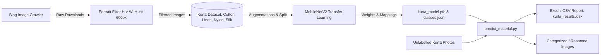

# 🧥 Kurta Fabric Classification & Image Processing Pipeline

An end-to-end Deep Learning and Computer Vision pipeline designed for Indian ethnic wear (Kurta & Kurti). This project covers automated dataset crawling, quality filtering, transfer learning with **MobileNetV2** in PyTorch, fabric/material classification (`Cotton`, `Linen`, `Nylon`, `Silk`), and automated batch inference with spreadsheet reporting.

---

## 📌 Table of Contents
- [Project Overview](#-project-overview)
- [Workflow Architecture](#-workflow-architecture)
- [Repository Structure](#-repository-structure)
- [Key Improvements & Bug Fixes](#-key-improvements--bug-fixes)
- [Installation & Setup](#-installation--setup)
- [Dataset Organization](#-dataset-organization)
- [Usage Guide](#-usage-guide)
  - [1. Data Collection & Filtering (`pykurta.py`)](#1-data-collection--filtering-pykurtapy)
  - [2. Model Training (`train_model.py`)](#2-model-training-train_modelpy)
  - [3. Batch Material Inference & Tagging (`predict_material.py`)](#3-batch-material-inference--tagging-predict_materialpy)
- [Configuration Reference (`config.py`)](#-configuration-reference-configpy)
- [Troubleshooting & FAQs](#-troubleshooting--faqs)

---

## 🌟 Project Overview

Understanding fabric composition from product imagery is a critical challenge in e-commerce cataloging and fashion analytics. This repository provides a modular, production-ready solution to:

1. **Automate Dataset Collection**: Scrapes targeted fashion photos from search engines and filters out landscape/low-resolution images, retaining portrait-oriented shots.
2. **Train a Convolutional Neural Network**: Uses a pre-trained **MobileNetV2** backbone with transfer learning to identify 4 fabric materials: `cotton`, `linen`, `nylon`, and `silk`.
3. **Automate Catalog Tagging**: Scans unlabelled folders of Kurta photos, runs inference with confidence scores, optionally categorizes or renames files, and exports detailed Excel (`.xlsx`) and CSV (`.csv`) audit reports.

---

## 📐 Workflow Architecture



---

## 📂 Repository Structure

```plaintext
kurta-project/
├── config.py                 # Central configuration (paths, classes, hyperparameters, device)
├── classes.json              # Model metadata & alphabetical class index mapping
├── pykurta.py                # Web scraper & portrait image curation pipeline
├── train_model.py            # PyTorch model training script (transfer learning)
├── predict_material.py       # Inference script (predictions, renaming, Excel reporting)
├── requirements.txt          # Python dependencies
├── .gitignore                # Git ignore rules for virtualenvs, caches, and temp files
├── README.md                 # Complete project documentation
├── kurta_model.pth           # Trained PyTorch MobileNetV2 weights (state_dict)
├── kurta_results.xlsx        # Generated prediction report spreadsheet
├── kurta_results.csv         # Fallback CSV report
└── kurta_dataset/            # Training dataset directory
    ├── cotton/               # Cotton kurta training samples
    ├── linen/                # Linen kurta training samples
    ├── nylon/                # Nylon kurta training samples
    └── silk/                 # Silk kurta training samples
```

---

## 🛠 Key Improvements & Bug Fixes

During deep code analysis of the original codebase, several critical bugs and structural issues were identified and permanently resolved:

| Component | Original Issue | Solution & Fix |
|---|---|---|
| **Class Label Mismatch** | `predict_material.py` defined `['cotton', 'nylon', 'silk', 'other']`, whereas `datasets.ImageFolder` indexed `['cotton', 'linen', 'nylon', 'silk']`. This caused `linen` to be falsely predicted as `nylon`, `nylon` as `silk`, and `silk` as `other`! | Unified classes in `config.py` and exported `classes.json`. Preserves exact alphabetical order matching `ImageFolder`. |
| **Excel Export Crash** | In `predict_material.py`, `pd.DataFrame(results, columns=["Image", "Material"])` was called on a 3-element array, throwing a pandas shape mismatch error, and overwriting files. | Built a clean tabular schema with columns: `Original_File`, `Predicted_Material`, `Confidence (%)`, `Assigned_Name`, `Action_Status`, and `Source_Path`. |
| **Hardcoded Paths** | Hardcoded Windows drive letters (`C:\KURTA_KURTI_DATASET`, `D:\KURTA_KURTI_DATASET`, `C:\kurta project`) prevented code portability. | Migrated to relative, system-agnostic `pathlib.Path` structures in `config.py` with CLI overrides. |
| **Missing Validation** | `train_model.py` had no train/val split, no validation metrics, and used deprecated `pretrained=True`. | Added 80/20 train/validation split, validation accuracy tracking, learning rate scheduling, and modern `weights` loading. |
| **Destructive Renaming** | Inference script renamed files without dry-run options or copy options. | Added `--action` flag with 3 modes: `none` (audit report only), `copy` (copy to category folders), and `rename` (safe in-place renaming). |
| **Silent Exception Swallowing** | Bare `except:` blocks concealed corrupted image reads and parsing failures. | Added targeted exception handling and comprehensive logging. |

---

## 🚀 Installation & Setup

### 1. Prerequisites
- Python 3.9, 3.10, 3.11, or 3.12 (PyTorch officially supports up to Python 3.12/3.13)
- Windows / macOS / Linux

### 2. Clone or Open Workspace
```bash
cd "d:/kurta project"
```

### 3. Set Up a Virtual Environment
```bash
# Create a fresh virtual environment
python -m venv .venv

# Activate on Windows PowerShell:
.venv\Scripts\Activate.ps1

# Activate on Windows Command Prompt:
.venv\Scripts\activate.bat

# Activate on macOS/Linux:
source .venv/bin/activate
```

### 4. Install Dependencies
```bash
pip install -r requirements.txt
```

---

## 📊 Dataset Organization

Ensure images are categorized by material subfolders inside `kurta_dataset/`:

```plaintext
kurta_dataset/
├── cotton/    (e.g., cotton kurta images)
├── linen/     (e.g., linen kurta images)
├── nylon/     (e.g., nylon/synthetic blend images)
└── silk/      (e.g., raw silk, tussar, cotton-silk images)
```

> **Note:** Folder names are automatically alphabetized by PyTorch's `ImageFolder`. Never manually reorder the classes in inference scripts.

---

## 💻 Usage Guide

### 1. Data Collection & Filtering (`pykurta.py`)
Scrapes portrait photos of Kurta and Kurti from Bing and filters out landscape or low-res images:

```bash
# Crawl images using default settings (500 images per category)
python pykurta.py

# Custom target and destination directory
python pykurta.py --target 1000 --output-dir "./crawled_images" --min-height 800
```

**CLI Flags:**
- `--output-dir`: Target folder where downloaded categories will be stored (default: `./crawled_images`).
- `--target`: Target number of filtered portrait images per category (default: `500`).
- `--min-height`: Minimum vertical pixel height required to keep an image (default: `600`).
- `--batch-size`: Number of images to fetch per query batch (default: `50`).

---

### 2. Model Training (`train_model.py`)
Trains MobileNetV2 on the `kurta_dataset/` directory with automatic train/val split:

```bash
# Train with defaults (10 epochs, batch size 16, lr 0.001)
python train_model.py

# Train with custom hyperparameters
python train_model.py --epochs 15 --batch-size 32 --lr 0.0005 --val-split 0.2
```

**Key Outputs:**
- `kurta_model.pth`: Saved PyTorch model weights (`state_dict`).
- `classes.json`: Exported label mapping to ensure prediction consistency.

---

### 3. Batch Material Inference & Tagging (`predict_material.py`)
Predicts material composition for single images or full directories of Kurta photos.

#### Mode A: Non-Destructive Audit & Report Only (Recommended)
Analyzes images and generates the Excel/CSV report without altering or moving files:
```bash
python predict_material.py --input "kurta_dataset/cotton" --action none
```

#### Mode B: Copy Images into Material Folders
Copies each image into a subfolder named after its predicted fabric (`output/cotton/`, `output/silk/`, etc.):
```bash
python predict_material.py --input "./unlabelled_photos" --action copy --output-dir "./categorized_output"
```

#### Mode C: Safe In-Place Renaming
Renames files directly in their folder to standard names (`cotton_1.jpg`, `silk_2.jpg`), automatically preventing filename collisions:
```bash
python predict_material.py --input "./unlabelled_photos" --action rename
```

**CLI Flags:**
- `--input`: Path to an image file or a directory containing images (default: `kurta_dataset`).
- `--model`: Path to model checkpoint file (default: `kurta_model.pth`).
- `--action`: Image file handling mode: `none`, `copy`, or `rename` (default: `none`).
- `--output-dir`: Destination folder when `--action copy` is selected.
- `--excel`: Output path for the Excel summary (default: `kurta_results.xlsx`).
- `--csv`: Output path for the CSV summary (default: `kurta_results.csv`).

---

## ⚙️ Configuration Reference (`config.py`)

All global parameters can be customized directly in `config.py`:

```python
# Image Input Specifications
IMAGE_SIZE = (224, 224)
NORM_MEAN = [0.485, 0.456, 0.406]
NORM_STD = [0.229, 0.224, 0.225]

# Training Defaults
BATCH_SIZE = 16
NUM_EPOCHS = 10
LEARNING_RATE = 0.001
VAL_SPLIT_RATIO = 0.2

# Hardware Acceleration
# Automatically uses CUDA GPU if detected, otherwise falls back to CPU
DEVICE = get_device()
```

---

## ❓ Troubleshooting & FAQs

### Q: Why do I get `ModuleNotFoundError: No module named 'openpyxl'`?
Install the optional Excel engine via pip:
```bash
pip install openpyxl
```
Even if `openpyxl` is missing, `predict_material.py` will automatically save `kurta_results.csv` as a fallback.

### Q: Why did the old script predict "other" or miss "linen"?
The old `predict_material.py` hardcoded `classes = ['cotton', 'nylon', 'silk', 'other']`, whereas PyTorch's `ImageFolder` sorted the dataset alphabetically as `['cotton', 'linen', 'nylon', 'silk']`. This index offset shifted predictions by one class. The new pipeline fixes this permanently with `config.py` and `classes.json`.

### Q: How do I train on GPU?
PyTorch will automatically detect an NVIDIA GPU if CUDA is installed. To verify, run:
```bash
python -c "import torch; print('CUDA Available:', torch.cuda.is_available())"
```
If `True`, `train_model.py` and `predict_material.py` will leverage GPU acceleration.

---

## 📜 License
This project is open-source and intended for educational and fashion research applications.
=======
# kurta_ai
An image classification project using Python, PyTorch, and MobileNetV2 to classify kurta fabrics into different material categories using deep learning.
